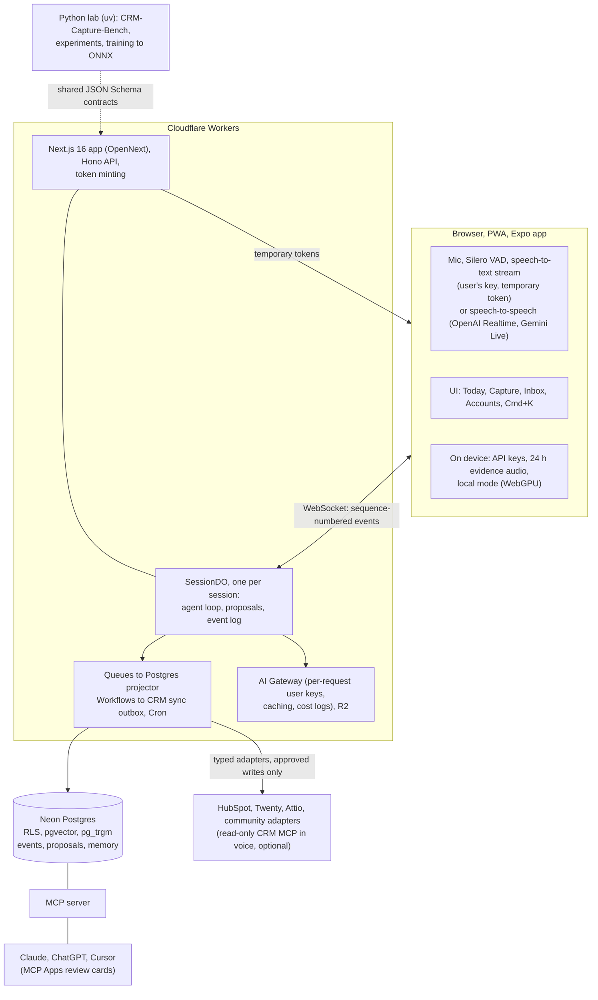
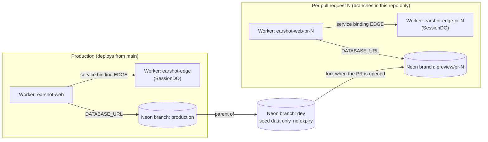
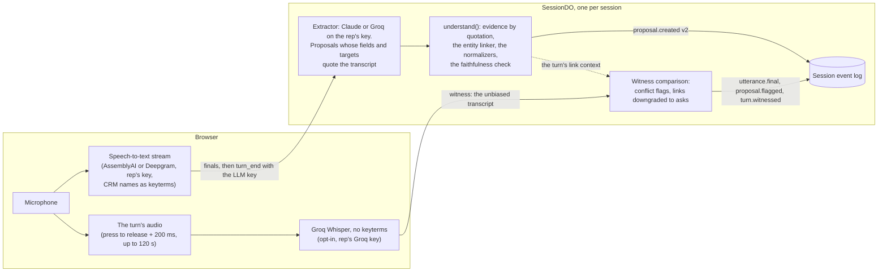
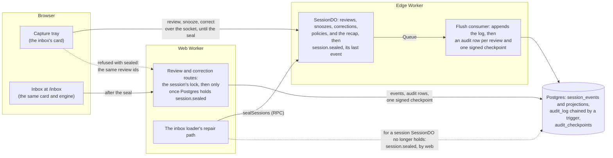

# Architecture

Earshot is an open-source, bring-your-own-key voice layer for CRMs. A rep talks through a debrief, Earshot turns it into typed, linked CRM proposals with the evidence behind each field, a human approves them, and approved changes sync to the CRM.

The core loop is **capture, understand, verify, sync, remember**.

This page shows the target system, what Phase 1 deploys, how Phase 4 turns a spoken turn into linked proposals, and how Phase 5's trust layer turns a proposal into a decision someone can check later. The reasons behind each choice are in the [decision records](adr/README.md). Some boxes in the system diagram arrive in later phases (see [ROADMAP.md](../ROADMAP.md)).

## System diagram (target)

## How the pieces fit

- **Voice.** The browser streams audio to a speech-to-text provider with the user's CRM names as keyterms. A second engine, speech-to-speech, handles conversational requests. Neither needs a media server ([ADR-0001](adr/0001-two-voice-engines-cascaded-by-default.md), [ADR-0002](adr/0002-browser-connects-to-providers-directly.md)).
- **Session brain.** Each session has one Durable Object that runs the agent loop and writes every event to an append-only log ([ADR-0003](adr/0003-durable-object-per-session.md), [ADR-0004](adr/0004-event-sourcing-for-sessions.md)).
- **Understanding.** Utterances become proposals. The model quotes what it heard, a deterministic linker resolves names to records in two stages, dates and amounts are re-read from the words, a biased and an unbiased transcript are compared, and each field carries its evidence ([ADR-0027](adr/0027-contracts-and-the-understanding-pipeline.md) to [ADR-0030](adr/0030-normalizers-and-faithfulness.md); see "The understanding pipeline (Phase 4)" below).
- **Verification and sync.** The model can only create proposals. A human approves them in the review inbox, or a policy the rep chose approves unmarked ones, and each decision lands on a hash-chained, signed audit trail. Only then, from Phase 6, do typed adapters write to the CRM ([ADR-0007](adr/0007-crm-writes-only-through-approved-proposals.md); see "The trust layer (Phase 5)" below).
- **Keys.** AI keys stay on the device by default ([ADR-0009](adr/0009-ai-keys-stay-on-the-device.md)).
- **Contracts.** Zod schemas in TypeScript export to JSON Schema, which generates the Pydantic models the Python lab uses ([ADR-0011](adr/0011-typescript-product-python-lab.md)).

## Phase 1 deployment

Phase 1 deploys two Workers and a Neon project. Production runs from `main`. Every pull request from a branch in this repository gets its own copy of the stack, with its own database branch forked from the seed-only `dev` branch ([ADR-0017](adr/0017-per-pr-environments.md)). Pull requests from forks get CI but no preview.

The `/api/health` route on each web Worker checks two paths: web to edge to Durable Object, and web to Postgres. The database check reads the branch name stored in the database, which shows the Worker is connected to the right branch.

When a PR closes, the web Worker, the edge Worker, and the Neon branch are deleted, in that order. A daily janitor removes anything left behind, and Neon branch expiry is the last backstop.

## The understanding pipeline (Phase 4)

One turn, from the rep's words to a `proposal.created` event. Everything right of the browser runs in the session's `SessionDO`. The understanding step is pure TypeScript, so a turn waits on nothing but the model's answer: no Postgres query, no second service.

1. **The biased transcript.** The browser streams audio to the speech-to-text provider with the CRM's names as keyterms, so names come out spelled the CRM's way. That helps when they're right and hides it when a similar name was misheard.
2. **Extraction** ([ADR-0025](adr/0025-llm-adapters-on-ai-sdk-7.md), Phase 4 amendment). The prompt carries no CRM list. The model returns proposals whose fields quote the transcript, and whose target is the name as the rep said it, never a record id.
3. **Linking** ([ADR-0028](adr/0028-entity-linking.md)). Candidates come from sound (Double Metaphone and a homophone list), character trigrams, and context: the account open in Earshot, earlier links in the session, and the company said alongside. A logistic scorer, calibrated Platt-style on the confusable-name set, gives each candidate a probability. The linker links when the best candidate's probability is at least τ_link and leads the runner-up by δ, proposes a new record when all candidates together fall below τ_new, and otherwise asks the rep. A link below 0.97 carries `link_uncertain`. Words that aren't in the transcript are never linked.
4. **Values** ([ADR-0030](adr/0030-normalizers-and-faithfulness.md)). Dates (chrono, plus Earshot's weekday rules) and amounts are re-read from the quoted words. Where the reading is unique and differs from the model's value, it replaces it; the model's value is kept beside it and flagged `value_mismatch`. Negations and self-corrections are checked against the words.
5. **The second witness** ([ADR-0029](adr/0029-the-second-witness-in-the-browser.md)). If the rep turned it on, the browser posts the turn's audio to Groq's Whisper with no keyterms and sends the transcript to `SessionDO`. `SessionDO` re-runs the linker on the witness's words in the same context. Where the two readings disagree, it flags `witness_conflict`, and a decided target (a link, or a new record) becomes a question.
6. **The gates** ([ADR-0031](adr/0031-eval-harness-v1.md)). `eval:linking --check` (the confusable-name set) and `eval:understanding --check` (200 debriefs through offline cassettes) run in CI's required `checks` job at $0. An opt-in live smoke eval runs a real model on 30 of the debriefs.

## The trust layer (Phase 5)

From a proposal to a decision someone can check later. A session's log has two writers that never write at once: `SessionDO` while the session is live and for a short grace after it ends, then the web Worker, once Postgres holds the session's seal. Every decision is a review event and a row on the workspace's audit chain.

| Where a session is | Who writes its log | What the client does |
|---|---|---|
| Live, before `end` | `SessionDO` | The tray reviews over the socket |
| Ended, not sealed: 60 s after `end` or the last write after it, at most 30 minutes (targets) | `SessionDO`: reviews, snoozes, corrections, usage, metrics, the recap | The tray keeps working; the inbox shows the debrief as "Finishing" |
| Sealed: `SessionDO` has written `session.sealed` | Nobody: `SessionDO` refuses every write with `sealed` | The tray hands its reviews to the web route, under the same ids |
| The seal reached Postgres | The web Worker, under the session's advisory lock | The inbox reviews, snoozes, and corrects |

1. **The card** ([ADR-0035](adr/0035-the-review-inbox.md)). One card, in the inbox, the capture tray, and the pilot. `tierOf` reads each proposal's flags and decisions into loud (amber, a first-person line written from a template, kept out of "accept all" and policies), quiet (a short note, or "matched by sound" beside the record's name), or none. Updates show the CRM's value when the rep spoke beside its value now, with three values when the CRM moved since. The inbox is a list with roving focus and focus-scoped single keys (a, e, r, s, c, u, 1–3) that Settings → Review can turn off, and every action is a real button.
2. **A decision** ([ADR-0032](adr/0032-reviews-undo-and-the-seal.md)). A `proposal.reviewed` v2 event: the decision, the record chosen, the mode (single, batch, policy, or system), what the card showed, the review clock's timings, and how the reviewer signed in. Undo is a later reopen, never a deletion. Each approval records `syncEligibleAt`, 30 s on, which Phase 6's sync must wait for. "Accept all" takes only unmarked cards, as one batch with one undo.
3. **Two writers, never at once** (ADR-0032, diagram above). `SessionDO` seals after its grace, and the web Worker writes nothing until Postgres holds the seal, under the same lock the flush takes, so no seq is claimed twice. The inbox's loader asks the edge Worker to seal sessions whose seal never came.
4. **The audit chain** ([ADR-0033](adr/0033-tamper-evident-approvals.md)). A `BEFORE INSERT` trigger chains every `audit_log` row per workspace with SHA-256, and the Worker that wrote a request's review rows signs the chain's head with Ed25519: the web Worker for the routes, the flush consumer for the socket. The key is a secret on both Workers; without it, reviews fail closed. An account export carries the chain, its checkpoints, and the public keys, and `db:audit-verify` checks it offline. Tamper-evident, not non-repudiation.
5. **Approval policies** ([ADR-0034](adr/0034-approval-policies.md)). Per workspace and type, versioned, changed only after a sign-in from the last 5 minutes. `POST /api/sessions` signs the latest version into each session's `start`, and `SessionDO` approves only unmarked, linked proposals a rule names, in the turn's own transaction, naming the policy in the review and on the chain.
6. **Evidence clips** ([ADR-0036](adr/0036-evidence-clips-on-the-device.md)). Each turn's audio, the same recording the second witness uses, encrypted on the device for 24 hours and never uploaded. A field's play button plays the words behind it; every card says why when there's no audio.
7. **The recap** ([ADR-0037](adr/0037-the-recap.md)). After `end`, one forced call on the session's own provider, on a key `end` carries. Code locates every sentence's quotes in the transcript and drops a sentence with none, before the seal.
8. **Corrections and follow-up questions** ([ADR-0038](adr/0038-corrections-and-follow-up-questions.md)). c takes typed words, or spoken ones on the capture screen, read by the linker and the normalizers into a proposal that supersedes the card, with no model call and no key: by `SessionDO` before the seal, by the web Worker's route after it. Rules ask for a missing due date, meeting date, or amount.
9. **The gates** ([ADR-0031](adr/0031-eval-harness-v1.md), [ADR-0039](adr/0039-review-time-evaluation.md)). CI's `checks` job holds the tiers to their budgets (loud at an interim 18%, any card marker at 35%, seeded errors marked at 95%) and runs `eval:recap`; its `ui` job runs the inbox's end-to-end tests with axe in every state, and the scripted reviewer, which decides the review pilot's 40 cards by keyboard and gates their markers, keys, and estimated time. The five-person pilot and the screen-reader passes are the maintainer's.

## Repository layout

Phase 1 set up `apps/web`, `apps/edge`, `packages/{core,db,tokens,ui,tsconfig}`, and `lab/`; the Fumadocs site was cut. Phases 2–4 added `packages/{events,keys,demo-crm,voice,agent,understanding,evals}`. Phase 5 added no packages: new subpaths (`@earshot/understanding/{tiers,correct,followups}`, `@earshot/agent/{recap,link-context}`, `@earshot/voice/evidence`, `@earshot/evals/{recap,pilot}`) and `docs/pilot/`. The names `packages/crm` and `apps/mobile` are reserved for later phases. See the README for the layout.
