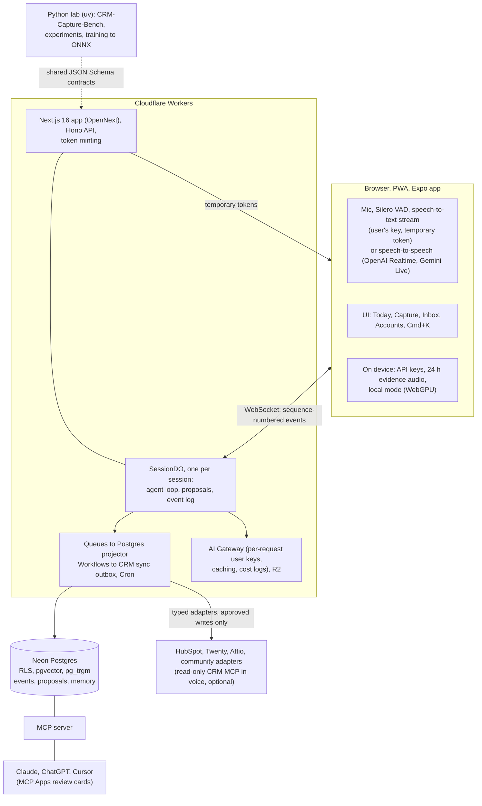
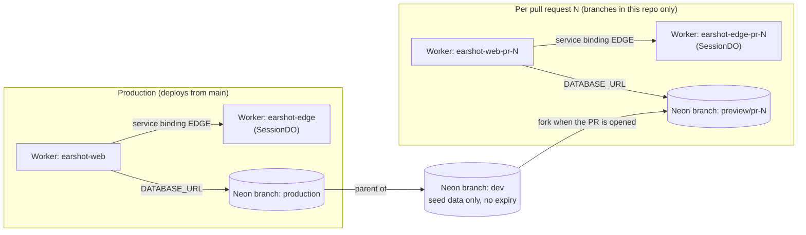
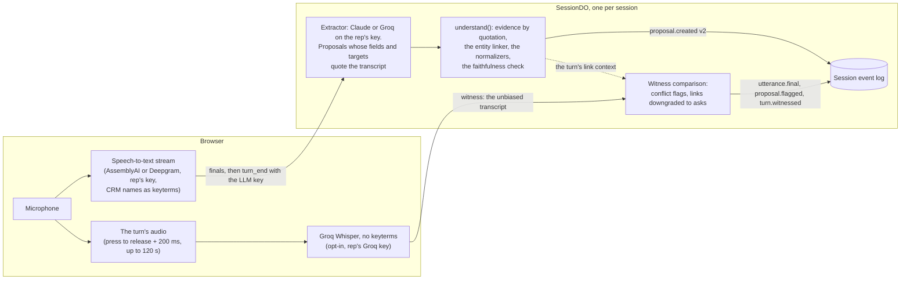

# Architecture

Earshot is an open-source, bring-your-own-key voice layer for CRMs. A rep talks through a debrief, Earshot turns it into typed, linked CRM proposals with the evidence behind each field, a human approves them, and approved changes sync to the CRM.

The core loop is **capture, understand, verify, sync, remember**.

This page shows the target system, what Phase 1 deploys, and how Phase 4 turns a spoken turn into linked proposals. The reasons behind each choice are in the [decision records](adr/README.md). Some boxes in the system diagram arrive in later phases (see [ROADMAP.md](../ROADMAP.md)).

## System diagram (target)

## How the pieces fit

- **Voice.** The browser streams audio to a speech-to-text provider with the user's CRM names as keyterms. A second engine, speech-to-speech, handles conversational requests. Neither needs a media server ([ADR-0001](adr/0001-two-voice-engines-cascaded-by-default.md), [ADR-0002](adr/0002-browser-connects-to-providers-directly.md)).
- **Session brain.** Each session has one Durable Object that runs the agent loop and writes every event to an append-only log ([ADR-0003](adr/0003-durable-object-per-session.md), [ADR-0004](adr/0004-event-sourcing-for-sessions.md)).
- **Understanding.** Utterances become proposals. The model quotes what it heard, a deterministic linker resolves names to records in two stages, dates and amounts are re-read from the words, a biased and an unbiased transcript are compared, and each field carries its evidence ([ADR-0027](adr/0027-contracts-and-the-understanding-pipeline.md) to [ADR-0030](adr/0030-normalizers-and-faithfulness.md); see "The understanding pipeline (Phase 4)" below).
- **Verification and sync.** The model can only create proposals. A human approves, and only then do typed adapters write to the CRM ([ADR-0007](adr/0007-crm-writes-only-through-approved-proposals.md)).
- **Keys.** AI keys stay on the device by default ([ADR-0009](adr/0009-ai-keys-stay-on-the-device.md)).
- **Contracts.** Zod schemas in TypeScript export to JSON Schema, which generates the Pydantic models the Python lab uses ([ADR-0011](adr/0011-typescript-product-python-lab.md)).

## Phase 1 deployment

Phase 1 deploys two Workers and a Neon project. Production runs from `main`. Every pull request from a branch in this repository gets its own copy of the stack, with its own database branch forked from the seed-only `dev` branch ([ADR-0017](adr/0017-per-pr-environments.md)). Pull requests from forks get CI but no preview.

The `/api/health` route on each web Worker checks two paths: web to edge to Durable Object, and web to Postgres. The database check reads the branch name stored in the database, which shows the Worker is connected to the right branch.

When a PR closes, the web Worker, the edge Worker, and the Neon branch are deleted, in that order. A daily janitor removes anything left behind, and Neon branch expiry is the last backstop.

## The understanding pipeline (Phase 4)

One turn, from the rep's words to a `proposal.created` event. Everything right of the browser runs in the session's `SessionDO`. The understanding step is pure TypeScript, so a turn waits on nothing but the model's answer: no Postgres query, no second service.

1. **The biased transcript.** The browser streams audio to the speech-to-text provider with the CRM's names as keyterms, so names come out spelled the CRM's way. That helps when they're right and hides it when a similar name was misheard.
2. **Extraction** ([ADR-0025](adr/0025-llm-adapters-on-ai-sdk-7.md), Phase 4 amendment). The prompt carries no CRM list. The model returns proposals whose fields quote the transcript, and whose target is the name as the rep said it, never a record id.
3. **Linking** ([ADR-0028](adr/0028-entity-linking.md)). Candidates come from sound (Double Metaphone and a homophone list), character trigrams, and context: the account open in Earshot, earlier links in the session, and the company said alongside. A logistic scorer, calibrated Platt-style on the confusable-name set, gives each candidate a probability. The linker links when the best candidate's probability is at least τ_link and leads the runner-up by δ, proposes a new record when all candidates together fall below τ_new, and otherwise asks the rep. A link below 0.97 carries `link_uncertain`. Words that aren't in the transcript are never linked.
4. **Values** ([ADR-0030](adr/0030-normalizers-and-faithfulness.md)). Dates (chrono, plus Earshot's weekday rules) and amounts are re-read from the quoted words. Where the reading is unique and differs from the model's value, it replaces it; the model's value is kept beside it and flagged `value_mismatch`. Negations and self-corrections are checked against the words.
5. **The second witness** ([ADR-0029](adr/0029-the-second-witness-in-the-browser.md)). If the rep turned it on, the browser posts the turn's audio to Groq's Whisper with no keyterms and sends the transcript to `SessionDO`. `SessionDO` re-runs the linker on the witness's words in the same context. Where the two readings disagree, it flags `witness_conflict`, and a decided target (a link, or a new record) becomes a question.
6. **The gates** ([ADR-0031](adr/0031-eval-harness-v1.md)). `eval:linking --check` (the confusable-name set) and `eval:understanding --check` (200 debriefs through offline cassettes) run in CI's required `checks` job at $0. An opt-in live smoke eval runs a real model on 30 of the debriefs.

## Repository layout

Phase 1 set up `apps/web`, `apps/edge`, `packages/{core,db,tokens,ui,tsconfig}`, and `lab/`; the Fumadocs site was cut. Phases 2–4 added `packages/{events,keys,demo-crm,voice,agent,understanding,evals}`. The names `packages/crm` and `apps/mobile` are reserved for later phases. See the README for the layout.
