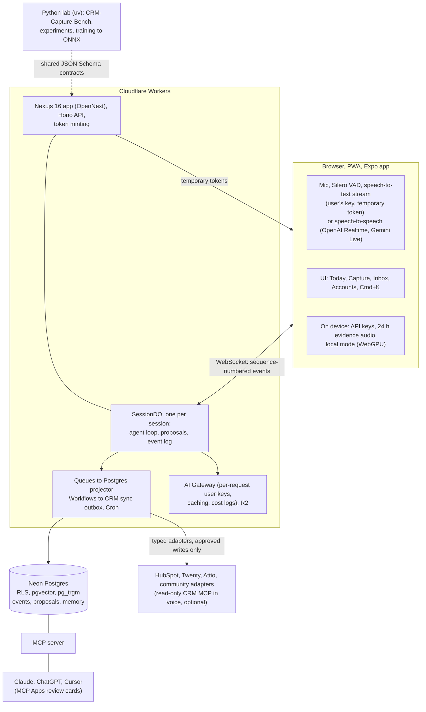
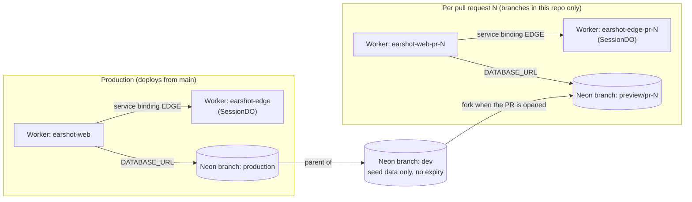

# Architecture

Earshot is an open-source, bring-your-own-key voice layer for CRMs. A rep talks through a debrief, Earshot turns it into typed, linked CRM proposals with the evidence behind each field, a human approves them, and approved changes sync to the CRM.

The core loop is **capture, understand, verify, sync, remember**.

This page shows the target system and what Phase 1 deploys. The reasons behind each choice are in the [decision records](adr/README.md). Phase 1 builds the foundations only: the monorepo, CI, per-PR environments, a design system, and skeletons of the web app and edge Worker. Most of the boxes in the system diagram arrive in later phases (see [ROADMAP.md](../ROADMAP.md)).

## System diagram (target)

## How the pieces fit

- **Voice.** The browser streams audio to a speech-to-text provider with the user's CRM names as keyterms. A second engine, speech-to-speech, handles conversational requests. Neither needs a media server ([ADR-0001](adr/0001-two-voice-engines-cascaded-by-default.md), [ADR-0002](adr/0002-browser-connects-to-providers-directly.md)).
- **Session brain.** Each session has one Durable Object that runs the agent loop and writes every event to an append-only log ([ADR-0003](adr/0003-durable-object-per-session.md), [ADR-0004](adr/0004-event-sourcing-for-sessions.md)).
- **Understanding.** Utterances become proposals. Entities are linked in two stages, a biased and an unbiased transcript are compared, and each field carries its evidence.
- **Verification and sync.** The model can only create proposals. A human approves, and only then do typed adapters write to the CRM ([ADR-0007](adr/0007-crm-writes-only-through-approved-proposals.md)).
- **Keys.** AI keys stay on the device by default ([ADR-0009](adr/0009-ai-keys-stay-on-the-device.md)).
- **Contracts.** Zod schemas in TypeScript export to JSON Schema, which generates the Pydantic models the Python lab uses ([ADR-0011](adr/0011-typescript-product-python-lab.md)).

## Phase 1 deployment

Phase 1 deploys two Workers and a Neon project. Production runs from `main`. Every pull request from a branch in this repository gets its own copy of the stack, with its own database branch forked from the seed-only `dev` branch ([ADR-0017](adr/0017-per-pr-environments.md)). Pull requests from forks get CI but no preview.

The `/api/health` route on each web Worker checks two paths: web to edge to Durable Object, and web to Postgres. The database check reads the branch name stored in the database, which shows the Worker is connected to the right branch.

When a PR closes, the web Worker, the edge Worker, and the Neon branch are deleted, in that order. A daily janitor removes anything left behind, and Neon branch expiry is the last backstop.

## Repository layout

Phase 1 sets up `apps/web`, `apps/edge`, `apps/docs`, `packages/{core,db,tokens,ui,tsconfig}`, and `lab/`. The names `packages/voice`, `packages/agent`, `packages/crm`, and `apps/mobile` are reserved for later phases. See the README for the layout.
